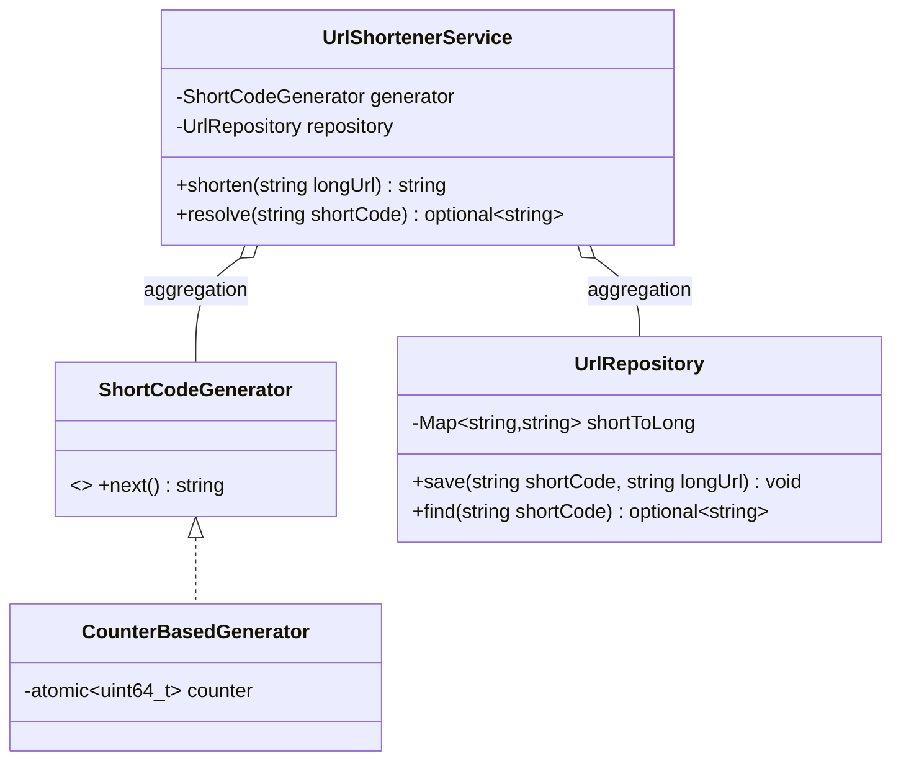

# 25 — URL Shortener

> Difficulty: foundational, and one of the single most commonly asked LLD
> problems industry-wide (alongside Parking Lot and LRU Cache) — short
> enough to be a 20-30 minute warm-up, but with a genuine algorithmic
> decision (how do you generate the short code?) that separates a
> thoughtful answer from a hand-wavy one.

## Step 1 — Clarify

Assumed answers:

- `shorten(longUrl)` returns a short code (or full short URL); `resolve(shortCode)`
  returns the original long URL, or indicates "not found."
- Short codes are a fixed-ish length, using a compact alphabet
  (alphanumeric: `[a-zA-Z0-9]`, 62 characters).
- The same long URL shortened twice may or may not return the same code —
  clarify explicitly which is wanted (this program assumes **not**
  deduplicated: every `shorten()` call mints a fresh code, since
  deduplication requires a reverse lookup with its own cost/consistency
  tradeoffs worth naming, not silently assuming).
- **Deferred, explicitly**: expiry/TTL on links (direct cross-reference to
  `19_inmemory_kv_store_with_ttl.md` if asked to add it), click analytics,
  custom/vanity short codes, and — the big one — actual **distributed
  uniqueness at scale**, which is the `18_distributed_id_generator.md`
  problem, not this one; this file is single-process.

## Step 2 — Entities

| Entity | Responsibility |
| --- | --- |
| `ShortCodeGenerator` (interface) | Produces the next short code — **growing set**, interface |
| `CounterBasedGenerator` | Concrete generator: base62-encodes an incrementing counter |
| `UrlRepository` | Stores the short-code ↔ long-URL mapping (the Repository pattern, `14_application_architecture_patterns.md`) |
| `UrlShortenerService` | Orchestrates shorten/resolve |

**The one real design decision on this problem**: how does
`ShortCodeGenerator` actually produce codes? Two standard approaches,
worth stating both and picking one deliberately:

1. **Counter + base62 encoding** (what's implemented below): an
   ever-incrementing integer ID, encoded into the `[a-zA-Z0-9]` alphabet.
   Guaranteed unique (no collisions possible, ever), guaranteed short
   (a 62^6 ≈ 56 billion code space at just 6 characters), but the counter
   itself is a single point of coordination — trivial in one process
   (an `std::atomic<uint64_t>`), a real distributed-systems problem across
   many servers (exactly why `18_distributed_id_generator.md`'s Snowflake
   scheme exists — name that connection explicitly).
2. **Random generation + collision check**: generate a random 6-7
   character code, check if it's taken, retry on collision. Simpler to
   distribute (no shared counter needed), but needs a uniqueness check per
   attempt and its retry rate climbs as the keyspace fills up — a real,
   if usually small, cost worth naming rather than ignoring.

## Step 3 — Class diagram



## Step 4-5 — Interfaces and core implementation

```cpp
#include <atomic>
#include <mutex>
#include <optional>
#include <string>
#include <unordered_map>

class ShortCodeGenerator {
public:
    virtual std::string next() = 0;
    virtual ~ShortCodeGenerator() = default;
};

// base62 alphabet: 0-9, a-z, A-Z -- 62 characters, so 6 characters gives
// 62^6 ~= 56.8 billion distinct codes, comfortably more than any single
// service will mint in practice.
class CounterBasedGenerator : public ShortCodeGenerator {
public:
    std::string next() override {
        uint64_t id = counter_.fetch_add(1, std::memory_order_relaxed);
        return encode(id);
    }

private:
    static std::string encode(uint64_t id) {
        static const std::string alphabet =
            "0123456789abcdefghijklmnopqrstuvwxyzABCDEFGHIJKLMNOPQRSTUVWXYZ";
        if (id == 0) return std::string(1, alphabet[0]);
        std::string result;
        while (id > 0) {
            result += alphabet[id % 62];
            id /= 62;
        }
        std::reverse(result.begin(), result.end());
        return result;
    }

    std::atomic<uint64_t> counter_{1};   // start at 1, not 0, so early codes aren't just "0", "1"...
};

class UrlRepository {
public:
    void save(const std::string& shortCode, const std::string& longUrl) {
        std::lock_guard<std::mutex> lock(mu_);
        shortToLong_[shortCode] = longUrl;
    }
    std::optional<std::string> find(const std::string& shortCode) {
        std::lock_guard<std::mutex> lock(mu_);
        auto it = shortToLong_.find(shortCode);
        if (it == shortToLong_.end()) return std::nullopt;
        return it->second;
    }

private:
    std::mutex mu_;
    std::unordered_map<std::string, std::string> shortToLong_;
};

class UrlShortenerService {
public:
    UrlShortenerService(std::unique_ptr<ShortCodeGenerator> generator,
                         std::unique_ptr<UrlRepository> repository)
        : generator_(std::move(generator)), repository_(std::move(repository)) {}

    std::string shorten(const std::string& longUrl) {
        std::string code = generator_->next();
        repository_->save(code, longUrl);
        return code;
    }
    std::optional<std::string> resolve(const std::string& shortCode) {
        return repository_->find(shortCode);
    }

private:
    std::unique_ptr<ShortCodeGenerator> generator_;
    std::unique_ptr<UrlRepository> repository_;
};
```

**Why the counter is `std::atomic<uint64_t>` rather than an `int`
guarded by a mutex**: this is the exact "single independent field →
atomic, not a mutex" call from `00_foundations/10_concurrency_for_lld.md`
— `fetch_add` alone is the entire invariant here, unlike `UrlRepository`'s
map (two related fields — well, one map, but a check-then-act sequence —
genuinely needs the mutex).

## Step 6 — Edge cases handled

- Resolving a short code that was never minted → `std::nullopt`, not an
  exception (an "expected absence," per the Result-pattern discussion in
  `14_application_architecture_patterns.md` — a bad/mistyped/expired short
  URL is a normal occurrence for this kind of service, not exceptional).
- The counter never repeats a value, so `CounterBasedGenerator` can never
  produce a duplicate code — no collision-handling logic needed at all
  with this approach, which is precisely its advantage over the random-
  generation alternative named in Step 2.

## Extensions (what a live follow-up usually asks)

**"What if the same long URL is shortened twice — should it return the
same short code?"** If yes: add a second map, `longToShort_`, checked
before minting a new code — a straightforward addition, but note the
tradeoff honestly: it means `UrlRepository` now enforces a stronger
invariant (one long URL → one short code) that needs its own consistent
locking (both maps must be updated together, atomically, under the same
lock) — a good moment to demonstrate you see the concurrency implication
of a seemingly simple feature request.

**"Add expiry so short codes stop working after 30 days."** Direct
composition with `19_inmemory_kv_store_with_ttl.md`'s TTL mechanism —
`UrlRepository`'s underlying store becomes a TTL-aware key-value store
instead of a bare `unordered_map`, with zero change to
`UrlShortenerService`'s interface.

**"How would this actually scale to a real product, across many
servers?"** This is where the honest boundary from Step 2 gets cashed in:
name the two real options — a centralized counter service (a single
source of truth for the next ID, becoming a bottleneck/single point of
failure at large enough scale) or a Snowflake-style distributed generator
(`18_distributed_id_generator.md`, each server mints IDs independently
using a node-ID segment) — and state which tradeoff you'd pick and why,
rather than pretending the single-process counter above scales as-is.

## Interview framing to reuse

"I used an incrementing counter with base62 encoding instead of random
generation with a collision check, specifically because it guarantees
zero collisions by construction rather than needing a retry loop — the
real cost of that choice is that the counter itself is a single point of
coordination, which is fine in one process and becomes the actual hard
problem the moment this needs to run across multiple servers." Precise,
and it's the sentence this whole problem is built to produce.

## Exercises

1. Implement the above from scratch in 20-25 minutes, then write a test
   confirming 1,000 consecutive `shorten()` calls all produce distinct
   codes, and that `resolve()` on each returns the correct original URL.
2. Add the "same long URL returns the same short code" extension, with
   correct locking across both maps, and write a test confirming two
   `shorten()` calls with the same input return the same code while a
   third with a different input gets a new one.
3. Implement the random-generation-with-collision-check alternative from
   Step 2, and write a benchmark comparing its average attempts-per-call
   at 10%, 50%, and 90% keyspace fill (using a small keyspace, like 2-character
   codes, to make the collision rate observable in a reasonable test run) —
   this makes the "retry rate climbs as the keyspace fills" claim concrete
   rather than asserted.
