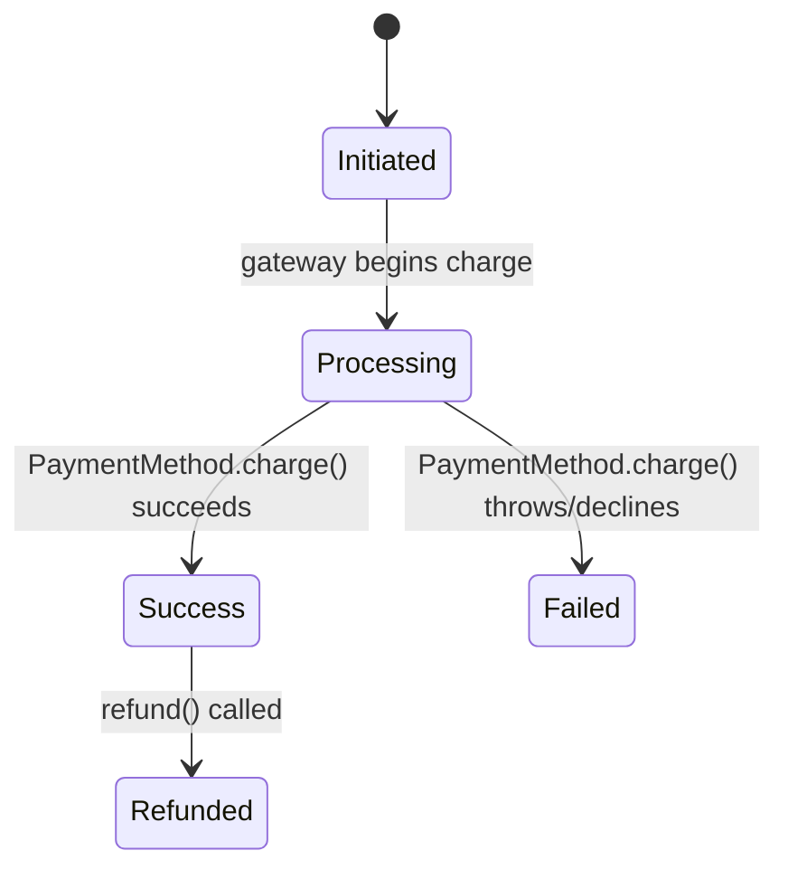
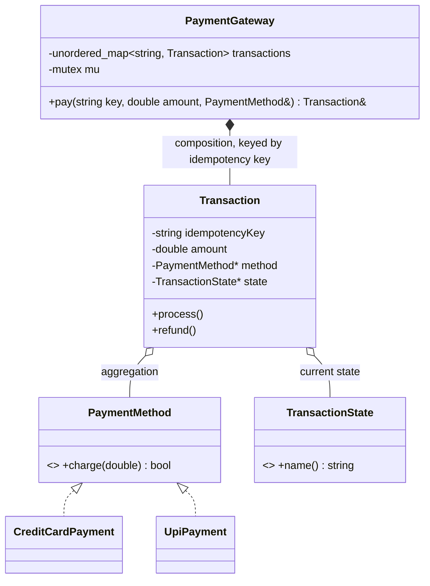

# 30 — Payment Gateway System

> Difficulty: advanced. Surfaced by cross-checking this roadmap against a
> popular YouTube LLD course — the teaching angle genuinely new to this
> set is **idempotency**: what happens when the exact same payment
> request arrives twice (a client retry after a timeout, a flaky mobile
> network), and how you design a class to make "charge the customer
> twice by accident" structurally hard to do, not just unlikely.

## Step 1 — Clarify

Assumed answers:

- A payment can be made via one of several methods (credit card, UPI,
  wallet) — pluggable, since real systems add payment methods constantly.
- Every payment attempt has a lifecycle:
  `INITIATED → PROCESSING → SUCCESS` or `PROCESSING → FAILED`, and a
  successful payment can later be `REFUNDED`.
- The caller (a checkout service, in a real system) supplies an
  **idempotency key** — a client-generated unique ID for "this logical
  payment attempt" — and retrying the same request with the same key must
  return the *original* result, never charge twice.
- **Deferred, explicitly**: real card network integration, fraud
  detection/3-D Secure, currency conversion, split payments — this design
  is the transaction state machine, payment-method abstraction, and
  idempotency guarantee, not a real payment processor's integration
  surface.

## Step 2 — Entities

| Entity | Responsibility |
| --- | --- |
| `PaymentMethod` (interface) | Actually moves money — `charge(amount)` — **growing set**, interface |
| `CreditCardPayment`, `UpiPayment`, `WalletPayment` | Concrete methods |
| `TransactionState` (interface) | What's legal to do *in this state* |
| `InitiatedState`, `ProcessingState`, `SuccessState`, `FailedState`, `RefundedState` | Concrete states |
| `Transaction` | One payment attempt: amount, method, current state, idempotency key |
| `PaymentGateway` | Orchestrates: dedupes by idempotency key, drives the state transitions |

**Why idempotency is a class-design problem, not just "check a database
row first"**: the naive fix — "look up the key, if it exists return the
old result" — has a real race: two retries of the *same* request arriving
concurrently can both miss the lookup (neither sees the other's row yet)
and both proceed to charge. The fix below makes the **claim atomic**: one
lock-protected "does this key already have a `Transaction`, and if not,
create and reserve it right now" step, the same check-then-act discipline
`02_parking_lot.md`'s slot assignment and `26_ride_sharing_service.md`'s
driver matching already use for a different resource — recognizing
idempotency-key deduplication as *the same shape* as those is the actual
transferable skill here.

## Step 3 — Class diagram





## Step 4-5 — Interfaces and core implementation

```cpp
#include <memory>
#include <mutex>
#include <stdexcept>
#include <string>
#include <unordered_map>

class PaymentMethod {
public:
    virtual bool charge(double amount) = 0;   // true = succeeded, false = declined
    virtual ~PaymentMethod() = default;
};
class CreditCardPayment : public PaymentMethod {
public:
    bool charge(double amount) override { return amount <= 5000.0; }   // simplified: a
                                                                          // real gateway calls
                                                                          // out to a card network
};
class UpiPayment : public PaymentMethod {
public:
    bool charge(double amount) override { return amount <= 100000.0; }
};

enum class TxnStatus { INITIATED, PROCESSING, SUCCESS, FAILED, REFUNDED };

class Transaction {
public:
    Transaction(std::string key, double amount, std::shared_ptr<PaymentMethod> method)
        : key_(std::move(key)), amount_(amount), method_(std::move(method)) {}

    // Idempotent by construction: calling process() again after it's
    // already resolved just returns the SAME result instead of charging
    // again -- this is the actual guarantee the whole design exists for.
    bool process() {
        if (status_ == TxnStatus::SUCCESS) return true;
        if (status_ == TxnStatus::FAILED)  return false;
        status_ = TxnStatus::PROCESSING;
        bool ok = method_->charge(amount_);
        status_ = ok ? TxnStatus::SUCCESS : TxnStatus::FAILED;
        return ok;
    }

    bool refund() {
        if (status_ != TxnStatus::SUCCESS) {
            throw std::logic_error("can only refund a successful transaction");
        }
        status_ = TxnStatus::REFUNDED;
        return true;
    }

    TxnStatus status() const { return status_; }
    const std::string& key() const { return key_; }

private:
    std::string key_;
    double amount_;
    std::shared_ptr<PaymentMethod> method_;
    TxnStatus status_ = TxnStatus::INITIATED;
};

class PaymentGateway {
public:
    // The idempotency guarantee lives entirely in this one method: the
    // lock covers "check for an existing transaction" AND "create+claim
    // a new one" as a single atomic step, so two concurrent calls with
    // the same key can never both create a Transaction and both charge.
    Transaction& pay(const std::string& idempotencyKey, double amount,
                      std::shared_ptr<PaymentMethod> method) {
        std::lock_guard<std::mutex> lock(mu_);
        auto it = transactions_.find(idempotencyKey);
        if (it != transactions_.end()) {
            return it->second;   // already seen this key -- return the EXISTING
                                   // transaction untouched, do not charge again
        }
        auto [inserted, ok] = transactions_.emplace(
            idempotencyKey, Transaction(idempotencyKey, amount, std::move(method)));
        inserted->second.process();
        return inserted->second;
    }

private:
    std::mutex mu_;
    std::unordered_map<std::string, Transaction> transactions_;
};
```

**Why the lock in `pay()` covers the lookup *and* the insert-and-process,
not just the lookup**: identical reasoning to every other
find-then-claim race in this problem set — releasing the lock between
"checked, not found" and "inserted and charged" reopens exactly the
window two concurrent retries would race through. This is worth stating
explicitly if an interviewer asks "is this thread-safe against a retry
storm" — a very plausible follow-up given the problem's whole premise is
about retries.

**Why `Transaction::process()` itself is also idempotent** (checking
`status_` before doing anything), not just `PaymentGateway::pay()`: two
independent layers of the same guarantee — `pay()` prevents a *second*
`Transaction` from being created for the same key; `process()` prevents
re-charging even if something *else* calls `process()` again directly on
an existing `Transaction` (a retry-scheduler bug, a duplicate internal
call) — defense in depth on the one invariant the whole system exists to
protect.

## Step 6 — Edge cases handled

- Same idempotency key, same amount, called twice (even concurrently) →
  charged exactly once, second caller gets the first call's result.
- `refund()` on a `FAILED` or already-`REFUNDED` transaction → throws
  `std::logic_error`, a genuine programming error (refunding something
  that was never charged, or was already refunded), not an expected
  outcome — contrast with `pay()` returning an existing transaction
  silently, which *is* expected.
- A declined charge (`charge()` returns `false`) → `FAILED` state, not an
  exception; a card decline is business-as-usual, not a bug.

## Extensions (what a live follow-up usually asks)

**"What if two different requests reuse the same idempotency key by
mistake, with a *different* amount?"** Name the real-world answer: that's
a client bug, and a production system detects it explicitly — store the
original request's amount alongside the key and reject a mismatched
replay with a clear error, rather than silently returning the (wrong)
cached result. A good live addition: a `std::logic_error` if
`amount != existing.amount()` inside `pay()`.

**"Partial refunds."** `refund(double amount)` instead of a boolean
refund, with a running `refundedAmount_` on `Transaction`, and a new
guard: total refunded can never exceed the original charge — the same
"invariant enforced at one point" instinct `03_oop_fundamentals.md`'s very
first `Account` example teaches, applied here.

**"How would this scale across multiple gateway instances (multiple
servers), where an in-memory `unordered_map` won't be shared?"** Name it
honestly: the idempotency-key deduplication needs to move to a shared
store (a database with a unique constraint on the key, or a distributed
cache with atomic check-and-set) — the *design*, one atomic claim per
key, stays identical; only *where* that atomic claim happens changes.
This is the LLD-round-appropriate depth; the full distributed version
belongs to the HLD track.

## Interview framing to reuse

"I treated idempotency as the central invariant of this design, not an
add-on — every entry point that could create or mutate a `Transaction`
checks and claims under one lock, and `Transaction` itself refuses to
re-execute a resolved payment even if asked twice. The payment-method
Strategy and the state machine are almost secondary to that guarantee,
even though they're the more visually obvious part of the class
diagram."

## Exercises

1. Implement the above from scratch in 45 minutes, then write a test
   calling `pay()` twice with the same idempotency key and a
   `CreditCardPayment`, confirming both calls return a `Transaction` in
   `SUCCESS` state and that `charge()` was only actually invoked once
   (add a call counter to a test-only `PaymentMethod` to verify this).
2. Write a concurrency stress test: many threads calling `pay()`
   simultaneously with the *same* idempotency key, asserting the
   underlying `charge()` is invoked exactly once across all of them.
3. Add the amount-mismatch guard from the Extensions section, and write a
   test confirming a replayed key with a different amount throws.
4. Implement partial refunds (`refund(double amount)`, a running
   `refundedAmount_`, and the never-exceed-original-charge guard), and
   write a test that two partial refunds summing to more than the
   original charge are rejected on the second call.
